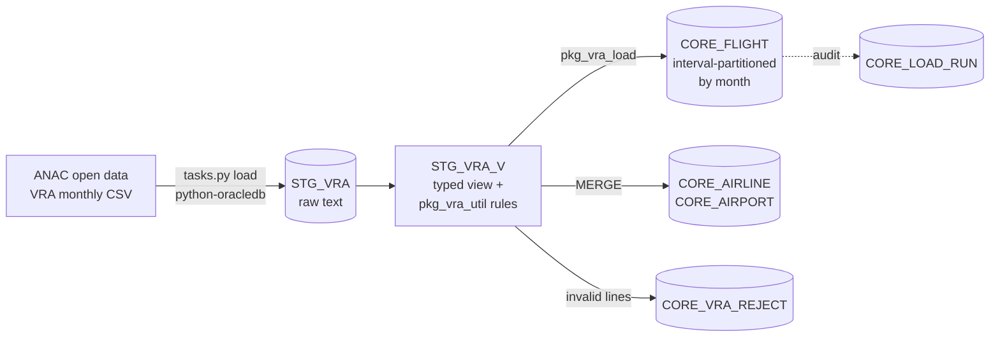

# Aviation OTP Observatory

**Free, open-source analytics on airline punctuality (on-time performance) for Brazil and Portugal, built on Oracle Database 23ai and PL/SQL.**

> 🇵🇹 *Observatório de Pontualidade Aérea: análise aberta e gratuita de atrasos e cancelamentos de voos, construída com Oracle PL/SQL. Guia passo a passo em português: [docs/FASE1.md](docs/FASE1.md).*


Brazil's civil aviation authority (ANAC) publishes every scheduled flight leg each month: planned vs. actual departure and arrival, and whether the flight was cancelled. That is hundreds of thousands of flights a month, but only as raw CSV files. This project turns them into a clean, tested, queryable data model, and later into a public dashboard and API.

## Status

| Phase | Scope | Status |
|---|---|---|
| **1. Foundation** | Oracle 23ai in Docker, staging → core model, PL/SQL load package, utPLSQL tests, CI | ✅ this release |
| 2. Analytics | Star schema, OTP / delay packages, materialized views, tuning report | planned |
| 3. Exposure | Spring Boot REST API, public dashboard on GitHub Pages | planned |
| 4. Ingestion & Portugal | Apache NiFi flow, Eurocontrol airport punctuality, OpenSky traffic | planned |

## Architecture (phase 1)



**Design choices worth a look**

- **Staging keeps the file as text.** Typing on read hides format errors, so the database decides what is valid, in one place (`STG_VRA_V`), with rules that are unit-tested (`pkg_vra_util`).
- **Nothing disappears silently.** Every rejected line goes to `CORE_VRA_REJECT` with a reason code; every run is logged in `CORE_LOAD_RUN` with staged / loaded / rejected / duplicate counts.
- **Idempotent monthly loads.** ANAC republishes old files, so a month is replaced as a whole inside one transaction. `CORE_FLIGHT` is interval-partitioned by month, so this only touches one partition.
- **Delays as virtual columns.** `ARR_DELAY_MIN`, `IS_CANCELLED` and `ON_TIME_15` are defined once in the table, so every query computes punctuality the same way.
- **Clear transaction contract.** `process_file` never commits. The run log is opened in an autonomous transaction, so failures stay visible even after a rollback, and SUCCESS is committed together with the data it describes.
- **Real tests.** utPLSQL suites cover parsing, validation, deduplication, idempotency and error paths, and run in GitHub Actions against a real Oracle 23ai container.

## Quick start

Requirements: Docker Engine with the Compose plugin (or Docker Desktop), Git, Python 3.11+, and about 4 GB of free RAM.
Developed on Debian 13; works the same on any Linux, macOS or Windows.

```bash
git clone https://github.com/Jano/aviation-otp-observatory.git
cd aviation-otp-observatory
python3 -m venv .venv && source .venv/bin/activate
pip install -r requirements.txt

python tasks.py up        # start Oracle Database 23ai Free (first time: a few minutes)
python tasks.py install   # schema OTP + utPLSQL + project objects
python tasks.py test      # run the unit tests
python tasks.py load --from 2026-01 --to 2026-07   # download and load real months
python tasks.py status    # what was loaded, flights and on-time % per month
```

Connect with any SQL client: host `localhost`, port `1521`, service `FREEPDB1`, user `otp`, password from `.env`.

Example query: punctuality by airline for one month.

```sql
select airline_icao,
       count(*)                           as flights,
       round(100 * avg(on_time_15), 1)    as on_time_pct,
       round(100 * avg(is_cancelled), 1)  as cancelled_pct
  from core_flight
 where ref_month = date '2026-07-01'
   and line_type = 'N'                    -- domestic
 group by airline_icao
having count(*) > 1000
 order by on_time_pct desc;
```

## Project layout

```
db/
  install.sql            master install script (SQL*Plus)
  ddl/                   tables (Oracle 23ai IF NOT EXISTS: safe to re-run)
  views/                 typed staging view
  packages/              pkg_vra_util (rules), pkg_vra_load (load)
  tests/                 utPLSQL suites and runner
loader/                  Python: read, download and stage VRA files
tests/python/            pytest suite (no database needed)
tests/fixtures/          22 real VRA lines, byte for byte
tasks.py                 cross-platform command runner
docs/                    data notes and step-by-step guide (PT)
```

## Data

- Source: [ANAC, Voo Regular Ativo (VRA)](https://www.gov.br/anac/pt-br/acesso-a-informacao/dados-abertos/areas-de-atuacao/voos-e-operacoes-aereas/voo-regular-ativo-vra), Brazilian government open data.
- What the files really look like, and the assumptions this project makes: [docs/data-notes.md](docs/data-notes.md).
- Raw data is never committed; `tasks.py load` downloads it.

## License

Code: MIT. Data: © ANAC, published as open data.
