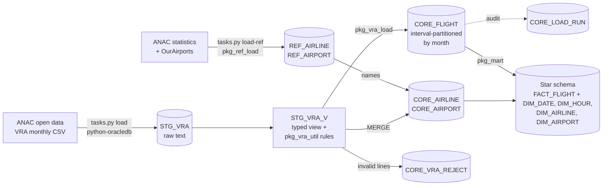

# Aviation OTP Observatory

[](https://github.com/Jano-Projects/aviation-otp-observatory/actions/workflows/ci.yml)


[](LICENSE)

**Open-source analytics of airline punctuality (on-time performance) built on Oracle AI Database 26ai (the successor of 23ai), PL/SQL and utPLSQL, using Brazil's official open flight data.**

> 🇵🇹 *Observatório de Pontualidade Aérea: análise aberta e gratuita de atrasos e cancelamentos de voos, construída com Oracle PL/SQL. Documentação em português: [guia de instalação](docs/pt/guia-instalacao.md) e [explicação do código](docs/pt/como-funciona.md).*

Every month, Brazil's civil aviation authority (ANAC) publishes every scheduled flight leg: planned and actual departure and arrival, and whether it was cancelled. That is 80 to 90 thousand flights a month, but only as raw CSV files. This project turns them into a validated, tested and queryable Oracle data model. A local web app and REST API on top of it live in a separate repository, [aviation-otp-apex](https://github.com/Jano-Projects/aviation-otp-apex) (Oracle APEX + ORDS).

## Results so far

January to July 2026, all scheduled flights (domestic and international) loaded from ANAC files:

| Month | Flights | Cancelled | On time (≤ 15 min) |
|---|---:|---:|---:|
| 2026-01 | 91,649 | 3.1% | 82.0% |
| 2026-02 | 79,455 | 3.0% | 82.7% |
| 2026-03 | 87,197 | 3.0% | 85.3% |
| 2026-04 | 80,375 | 2.9% | 80.9% |
| 2026-05 | 82,098 | 2.9% | 84.9% |
| 2026-06 | 81,119 | 3.6% | 80.7% |
| 2026-07 | 89,488 | 3.0% | 83.3% |
| **Total** | **591,381** | **3.1%** | |

591,381 lines loaded, 0 rejected by validation. All 87 airlines and 289 airports in these flights carry a name, from ANAC and OurAirports reference data. *On time* = arrived at most 15 minutes after schedule (the industry-standard OTP15), measured over flown legs with both scheduled and actual arrival times.

## How it works



**Python only moves data; Oracle decides.** Python downloads each file and copies it, as text, into a staging table. Every rule (what is valid, how a delay is computed, what is a duplicate) lives in PL/SQL, in one place, under unit tests.

Design choices worth a look:

- **Staging keeps the file as text.** Typing on read hides format errors, so the database validates in one place (`STG_VRA_V`) with unit-tested rules (`pkg_vra_util`).
- **Nothing disappears silently.** Every rejected line goes to `CORE_VRA_REJECT` with a reason code; every run is logged in `CORE_LOAD_RUN` with staged, loaded, rejected and duplicate counts.
- **Idempotent monthly loads.** ANAC republishes old files, so a month is replaced as a whole in one transaction. `CORE_FLIGHT` is interval-partitioned by month, so a reload touches one partition.
- **Delays as virtual columns.** `ARR_DELAY_MIN`, `IS_CANCELLED` and `ON_TIME_15` are defined once in the table, so every query measures punctuality the same way.
- **Clear transaction contract.** `process_file` never commits. Its run log opens in an autonomous transaction, so failures stay visible after a rollback, while SUCCESS is committed together with the data it describes.
- **Precise error handling.** Impossible dates (ORA-018xx) become NULL; any other error is re-raised, never swallowed.
- **A star schema for analysis.** `FACT_FLIGHT` (one row per flight, partitioned by month) with date, hour, airline and airport dimensions on surrogate keys. Fact foreign keys are `RELY DISABLE NOVALIDATE`: declared for the optimizer, guaranteed by the load. Each month is rebuilt atomically; phase 2.4 compares this with a partition exchange.
- **Two reference sources, explicit precedence.** ANAC gives official names in Portuguese; OurAirports fills the official airport name, IATA code and coordinates, and the codes ANAC lacks. The rules live in one MERGE, under tests.

More detail: [docs/architecture.md](docs/architecture.md) · data format and assumptions: [docs/data-notes.md](docs/data-notes.md).

## Quick start

Requirements: Docker Engine with the Compose plugin (or Docker Desktop), Git, Python 3.11+, about 4 GB of free RAM. Developed on Debian 13 and Fedora (SELinux enforcing); works the same on any Linux, macOS or Windows.

```bash
git clone https://github.com/Jano-Projects/aviation-otp-observatory.git
cd aviation-otp-observatory
python3 -m venv .venv && source .venv/bin/activate
pip install -r requirements.txt

python tasks.py up        # start Oracle AI Database 26ai Free (first time: a few minutes)
python tasks.py install   # schema OTP + utPLSQL + project objects
python tasks.py test      # run the utPLSQL unit tests
python tasks.py load --from 2026-01 --to 2026-07 --keep-going   # download and load real months
python tasks.py load-ref  # airline and airport names (ANAC + OurAirports, ~370 MB, once)
python tasks.py mart      # rebuild the star schema (load already does it for new months)
python tasks.py status    # load runs, flights and on-time % per month
```

All commands: `python tasks.py --help`. Step-by-step guide for Debian and Fedora, including a VirtualBox VM (in Portuguese): [docs/pt/guia-instalacao.md](docs/pt/guia-instalacao.md).

Connect with any SQL client: host `localhost`, port `1521`, service `FREEPDB1`, user `otp`, password from `.env`. Example: punctuality by airline, domestic flights, first half of 2026.

```sql
select airline_icao,
       count(*)                           as flights,
       round(100 * avg(on_time_15), 1)    as on_time_pct,
       round(100 * avg(is_cancelled), 1)  as cancelled_pct
  from core_flight
 where ref_month between date '2026-01-01' and date '2026-06-01'
   and line_type = 'N'
 group by airline_icao
having count(*) > 5000
 order by on_time_pct desc;
```

**Database version.** The `gvenzl/oracle-free:23` image follows Oracle's releases: today it ships **Oracle AI Database 26ai Free 23.26.3**, the successor of 23ai (features such as `CREATE TABLE IF NOT EXISTS` work the same). The project is tested with that version; `python tasks.py sql` and `select banner_full from v$version` show which one you have.

## Testing

| Suite | Tool | Tests | What it covers |
|---|---|---:|---|
| `db/tests/test_pkg_vra_util` | utPLSQL | 10 | date parsing, null tokens, impossible dates, file names, every reject reason |
| `db/tests/test_pkg_vra_load` | utPLSQL | 8 | loading, rejects, duplicates, idempotency, dimensions, audit log, error paths |
| `db/tests/test_pkg_ref_load` | utPLSQL | 10 | coordinates, latest-year names, source precedence, code matching, copy to core, audit |
| `db/tests/test_pkg_mart` | utPLSQL | 9 | calendar in Portuguese, hour periods, dimensions, fact keys and measures, idempotency, audit |
| `tests/python/test_vra_file.py` | pytest | 15 | header detection, current and legacy layouts, download URLs |
| `tests/python/test_reference.py` | pytest | 8 | ANAC statistics and OurAirports readers |

GitHub Actions runs everything on every push: the pytest suite, then a real Oracle 23ai container where it installs the schema, runs the utPLSQL suites and loads a sample of real ANAC lines end to end.

## Project layout

```
├── README.md
├── CHANGELOG.md
├── docker-compose.yml        Oracle AI Database Free container (gvenzl/oracle-free:23)
├── tasks.py                  command runner: up, install, test, load, status, sql, down, reset
├── requirements*.txt
├── db/                       everything that runs inside Oracle (SQL*Plus scripts)
│   ├── install.sql           master install script
│   ├── admin/                schema creation, invalid-object check
│   ├── ddl/                  tables and indexes (Oracle 23ai IF NOT EXISTS: safe to re-run)
│   ├── views/                typed staging view
│   ├── packages/             pkg_vra_util (rules), pkg_vra_load (load), pkg_ref_load (names),
│   │                         pkg_mart (star schema), pkg_load_log (audit)
│   └── tests/                utPLSQL suites and runner
├── loader/                   Python: read, download and stage VRA and reference files
├── tests/
│   ├── python/               pytest suite (no database needed)
│   └── fixtures/             real samples of each source (VRA, ANAC statistics, OurAirports)
├── docs/                     documentation (see below)
└── .github/workflows/ci.yml  CI pipeline
```

## Documentation

| Document | Language | For |
|---|---|---|
| [docs/architecture.md](docs/architecture.md) | English | data model, PL/SQL API, load sequence, testing strategy |
| [docs/data-notes.md](docs/data-notes.md) | English | the real format of ANAC files and the assumptions made |
| [docs/pt/guia-instalacao.md](docs/pt/guia-instalacao.md) | Português | installing from scratch on Debian 13 or Fedora, step by step |
| [docs/pt/como-funciona.md](docs/pt/como-funciona.md) | Português | every file of the project explained |
| [CHANGELOG.md](CHANGELOG.md) | English | what changed in each version |

## Roadmap

| Phase | Scope | Status |
|---|---|---|
| **1. Foundation** | Oracle Free in Docker, staging → core model, PL/SQL load package, utPLSQL tests, CI | ✅ done |
| 2. Analytics | ✅ 2.1 reference data · ✅ 2.2 star schema · 2.3 `pkg_otp` indicators and materialized views · 2.4 tuning report (incl. partition exchange) | in progress |
| 3. Exposure | 3A local web app and REST API with Oracle APEX + ORDS ([aviation-otp-apex](https://github.com/Jano-Projects/aviation-otp-apex)) · 3B Spring Boot REST API · 3C FastAPI · public dashboard on GitHub Pages | in progress |
| 4. Ingestion and Portugal | Apache NiFi flow, Eurocontrol airport punctuality, OpenSky traffic | planned |

## Data and license

- Flights: [ANAC, Voo Regular Ativo (VRA)](https://www.gov.br/anac/pt-br/acesso-a-informacao/dados-abertos/areas-de-atuacao/voos-e-operacoes-aereas/voo-regular-ativo-vra), Brazilian government open data.
- Airline and airport names: ANAC *Dados Estatísticos do Transporte Aéreo* (open data) and [OurAirports](https://ourairports.com/data/) (public domain).
- Raw files are never committed; `tasks.py load` and `load-ref` download them.
- Code: [MIT](LICENSE). Data: © ANAC, published as open data; OurAirports data is in the public domain.

## Author

**Victor Hugo dos Santos Correa**, Oracle PL/SQL developer. [LinkedIn](https://www.linkedin.com/in/victor-hsc)
