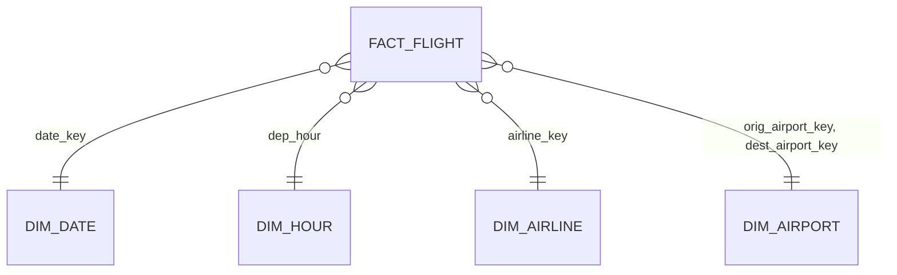

# Architecture

How the project is put together: the data layers, the tables, the PL/SQL API, the load
sequence and how it is tested. For the file format of the source data, see
[data-notes.md](data-notes.md).

## Principles

1. **Python moves data, Oracle decides.** The Python loader never interprets values. It copies
   each file, as text, into staging. Validation, typing, deduplication and every derived value
   are PL/SQL or SQL, in one place, under unit tests.
2. **Nothing disappears silently.** A line is either loaded, rejected with a reason, or counted
   as an exact duplicate. The three counts always add up to the lines staged.
3. **Every load can be repeated.** Installing, testing and loading are idempotent: running a
   command twice gives the same result as running it once.
4. **Reproducible from scratch.** The database is always the result of code plus public data.
   Any machine (including CI) rebuilds it with `up`, `install` and `load`.

## Data layers

| Layer | Objects | Content | Written by |
|---|---|---|---|
| Staging | `STG_VRA` | the source file line by line, every column `VARCHAR2` | Python loader |
| Transformation | `STG_VRA_V` | staging typed (`DATE`, trimmed codes) plus `REJECT_REASON` per line | view over `STG_VRA` |
| Core | `CORE_FLIGHT`, `CORE_AIRLINE`, `CORE_AIRPORT` | validated, deduplicated flights and their dimensions | `pkg_vra_load` (names: `pkg_ref_load`) |
| Reference | `STG_REF_AIRLINE`, `STG_REF_AIRPORT_ANAC`, `STG_REF_AIRPORT_OA` → `REF_AIRLINE`, `REF_AIRPORT` | airline and airport names and attributes from two sources | Python loader, `pkg_ref_load` |
| Audit | `CORE_LOAD_RUN`, `CORE_VRA_REJECT` | one row per load run; every rejected line with its reason | `pkg_load_log`, `pkg_vra_load` |
| Mart | `FACT_FLIGHT`, `DIM_DATE`, `DIM_HOUR`, `DIM_AIRLINE`, `DIM_AIRPORT` | star schema for analysis | `pkg_mart` |

## Tables

| Table | Key | Notes |
|---|---|---|
| `STG_VRA` | `(SRC_FILE, LINE_NO)` | lineage: every value traces back to a file and line |
| `CORE_LOAD_RUN` | `RUN_ID` (identity) | status `RUNNING` → `SUCCESS` or `FAILED`; counts staged, loaded, rejected, duplicate |
| `CORE_VRA_REJECT` | `(RUN_ID, LINE_NO)` | reason code and the original line |
| `CORE_AIRLINE` | `AIRLINE_ICAO` (3 chars) | first and last month seen; name copied from `REF_AIRLINE` |
| `CORE_AIRPORT` | `AIRPORT_ICAO` (4 chars) | first and last month seen; display name and ISO country copied from `REF_AIRPORT` |
| `REF_AIRLINE` | `AIRLINE_ICAO` | ANAC name of the most recent year, nationality |
| `REF_AIRPORT` | `AIRPORT_ICAO` | official name, city, state, country (PT), ISO country, continent, IATA, coordinates, `NAME_SOURCE` |
| `CORE_FLIGHT` | `FLIGHT_ID` (identity) | interval-partitioned by `REF_MONTH`; local indexes; foreign keys to both dimensions |

`CORE_FLIGHT` virtual columns:

| Column | Definition |
|---|---|
| `DEP_DELAY_MIN` | `round((dep_actual - dep_sched) * 1440)` |
| `ARR_DELAY_MIN` | `round((arr_actual - arr_sched) * 1440)` |
| `IS_CANCELLED` | `1` when status is `CANCELADO`, else `0` |
| `ON_TIME_15` | `1` if flown and arrived ≤ 15 min late, `0` if later, `NULL` when not measurable |

`ON_TIME_15` is `NULL`, not `0`, for cancelled flights and flights without a schedule, so
`avg(on_time_15)` is the on-time rate directly.

## PL/SQL API

### `pkg_vra_util`: pure functions (no table access, all `DETERMINISTIC`)

| Function | Returns |
|---|---|
| `to_ts(p_value)` | `DATE` from `YYYY-MM-DD HH24:MI[:SS[.fraction]]` or `DD/MM/YYYY HH24:MI`; `NULL` for empty, `null`, `N/A`, unknown formats and impossible dates |
| `ref_month_from_file(p_file_name)` | first day of the month encoded in `VRA_20267.csv` or `VRA_2025_07.csv`; `NULL` if none |
| `reject_reason(...)` | `NULL` for a valid line, otherwise the first problem found |

Reject reasons, in the order they are checked:

| Code | Meaning |
|---|---|
| `INVALID_AIRLINE` | airline code is not exactly 3 letters or digits |
| `INVALID_FLIGHT_NO` | flight number missing or longer than 10 characters |
| `INVALID_ORIGIN` / `INVALID_DESTINATION` | aerodrome code is not exactly 4 letters or digits |
| `INVALID_STATUS` | status is neither `REALIZADO` nor `CANCELADO` |
| `INVALID_DEP_SCHED`, `INVALID_DEP_ACTUAL`, `INVALID_ARR_SCHED`, `INVALID_ARR_ACTUAL` | a timestamp is present but cannot be parsed |
| `NO_DEPARTURE_TIME` | neither scheduled nor actual departure |
| `DONE_WITHOUT_ACTUALS` | flown (`REALIZADO`) but without actual times |

### `pkg_load_log`: the run log, shared by every load

| Routine | Transaction |
|---|---|
| `start_run(p_src_file, p_ref_month)` | autonomous: the `RUNNING` row survives a rollback |
| `mark_success(p_run_id, counts...)` | the caller's: `SUCCESS` commits or rolls back with the data |
| `mark_failed(p_run_id, p_error)` | autonomous: the failure stays recorded |

### `pkg_vra_load`

```sql
function process_file(p_src_file in varchar2, p_ref_month in date default null) return number;
```

Loads one staged file and returns its `RUN_ID`. Raises `ORA-20001` (`e_no_ref_month`) when the
month cannot be derived, and `ORA-20002` (`e_no_staged_rows`) when nothing is staged.

**Transaction contract:** it never commits. The caller commits (the Python loader, once per
file) or rolls back (unit tests).

### `pkg_ref_load`

```sql
function process_reference(p_anac_file in varchar2, p_oa_file in varchar2) return number;
function sync_core return pls_integer;
function to_coord(p_value in varchar2) return number deterministic;
```

Precedence rules, all in one `MERGE` per table:

| Attribute | Source |
|---|---|
| airline name, nationality | ANAC, the most recent year reported for the code |
| airport city, state, country (Portuguese), continent | ANAC, the most recent year |
| airport official name, IATA code, ISO country, coordinates | OurAirports |
| airports ANAC does not know | OurAirports alone (`NAME_SOURCE = 'OURAIRPORTS'`) |

An OurAirports row matches a 4-character code by `icao_code` first, then `ident`, then
`gps_code`; among matches of the same strength, larger airports win (a heliport never takes an
airport's code). `sync_core` copies names onto `CORE_AIRLINE` and `CORE_AIRPORT`; the `load`
command calls it after every month, so new codes get names at once.

### `pkg_mart`: the star schema

```sql
procedure build_dim_date(p_from in date, p_to in date);
function  refresh_dimensions return pls_integer;
function  refresh_month(p_month in date) return number;   -- RUN_ID, logged as 'MART YYYY-MM'
function  refresh_all return pls_integer;                  -- months refreshed
```



| Table | Grain | Notes |
|---|---|---|
| `FACT_FLIGHT` | one flight leg (one `CORE_FLIGHT` row) | interval-partitioned by `MONTH_START`; measures `IS_FLOWN`, `IS_CANCELLED`, `IS_MEASURABLE`, `ON_TIME_15`, delays; `FLIGHT_ID` kept as degenerate dimension |
| `DIM_DATE` | one day, key `YYYYMMDD` | Portuguese month and day names computed without NLS (`'IW'`, `'Q'`, date arithmetic); ISO weekday and week; weekend flag |
| `DIM_HOUR` | one hour, 0 to 23 | period of the day: madrugada (0-5), manhã (6-11), tarde (12-17), noite (18-23) |
| `DIM_AIRLINE` | one airline | surrogate identity key, name and nationality (SCD type 1) |
| `DIM_AIRPORT` | one airport, used for origin and destination | surrogate key, name, city, state, country, coordinates, `IS_BRAZIL` |

Design notes:

- **Date of a flight** = scheduled departure, or actual departure for unscheduled flights.
- **Fact foreign keys are `RELY DISABLE NOVALIDATE`**: the optimizer can use them (join
  elimination, query rewrite in phase 2.3), but rows are not checked one by one. Integrity comes
  from the load: facts are built with inner joins to the dimensions, and any flight left out is
  counted as rejected in `CORE_LOAD_RUN`. Because a `RELY` foreign key may only reference a `RELY` primary
  key (ORA-25158), the dimension primary keys are declared `RELY` as well.
- **Refresh** = `DELETE` the month + `INSERT ... SELECT`, inside the caller's transaction: atomic
  and unit-testable. Phase 2.4 measures it against a partition exchange.

## Load sequence

```
python tasks.py load --from 2026-07
 1. download.py   downloads VRA_20267.csv to data/raw/ (skipped if already there)
 2. vra_file.py   finds the header, maps columns by name (current and legacy layouts)
 3. db.py         deletes the file's previous staging rows, inserts in batches of 10,000
 4. db.py         calls pkg_vra_load.process_file
     4.1 start_run          CORE_LOAD_RUN row 'RUNNING'       (autonomous transaction)
     4.2 savepoint
     4.3 reject_invalid     invalid lines → CORE_VRA_REJECT
     4.4 register_*         MERGE new airlines and airports
     4.5 replace_month      DELETE the month, INSERT DISTINCT valid lines
     4.6 mark_success       counts, status 'SUCCESS'          (same transaction as the data)
     on error: rollback to savepoint, mark_failed (autonomous), re-raise
 5. db.py         COMMIT, once
```

## Install and tooling

- `tasks.py` is the single entry point. It runs SQL*Plus **inside** the container
  (`docker compose exec`), so no Oracle client is needed on the host; the Python loader uses
  `python-oracledb` in thin mode on port 1521.
- `db/install.sql` installs in dependency order (tables → package specs → view → package
  bodies) and ends with `admin/check_invalid.sql`, which fails the install if any object is
  invalid. SQL*Plus reports PL/SQL compilation errors only as warnings, so this check is what
  makes a broken package fail CI.
- Tables use `CREATE TABLE IF NOT EXISTS` (Oracle 23ai) and code uses `CREATE OR REPLACE`, so the
  install can be re-run at any time.

## Testing strategy

| Level | Tool | Runs | Data |
|---|---|---|---|
| Unit: parsing and rules | utPLSQL (`test_pkg_vra_util`) | `tasks.py test`, CI | literal values |
| Unit: load behaviour | utPLSQL (`test_pkg_vra_load`) | `tasks.py test`, CI | 6 invented lines in month 2099, rolled back after each test |
| Unit: reference merge | utPLSQL (`test_pkg_ref_load`) | `tasks.py test`, CI | invented codes (`ZZA`, `ZZZA`, `ZZZB`), rolled back after each test |
| Unit: star schema | utPLSQL (`test_pkg_mart`) | `tasks.py test`, CI | 4 invented flights in month 2099, rolled back after each test |
| Unit: file reading | pytest | `pytest`, CI | real samples of each source (`tests/fixtures`) |
| End to end | CI job | every push | the real sample loaded into a fresh Oracle |

`db/tests/run_tests.sql` runs every suite, deletes the audit rows the tests leave behind (they
are written in autonomous transactions on purpose), and exits with an error code if any test
failed or errored.
